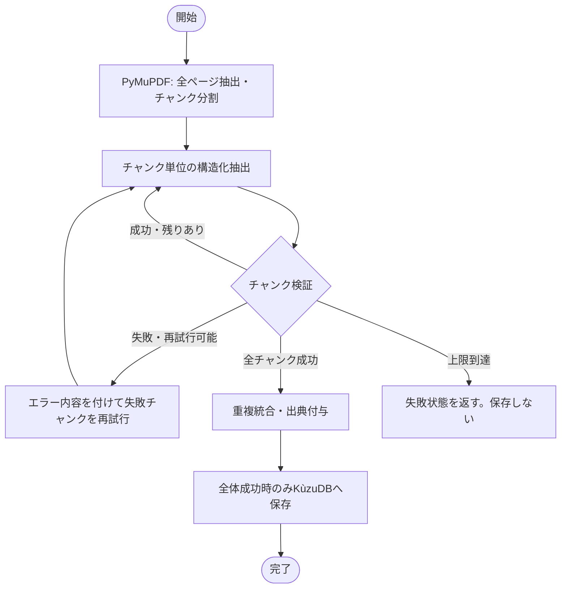
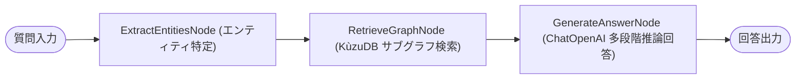

# arxiv-ocr-langgraph (LLM GraphRAG with LangGraph)

## プロジェクト概要

arXiv の学術論文の中から **LLM（大規模言語モデル）分野の論文** を対象に、「モデルや手法同士の派生関係（例: LLaMA → Alpaca → Vicuna）」や「どのベンチマークデータセット（MMLU, GSM8K 等）でどんな性能を出したか」という関係性を抽出し、多段階推論が可能なグラフ RAG（GraphRAG）を **LangGraph** を用いて構築する。

---

## 論文の対象選定方針（アプローチ: arXiv API フィルタリング）

ノイズとなる他分野（画像認識、物理、ロボティクス等）の論文を除外し、**LLM 関連論文のみを確実に収集** するため、arXiv API によるカテゴリおよびキーワード絞り込みを採用する。

* **指定カテゴリ**: `cs.CL`（Computation and Language: 自然言語処理分野）
* **検索キーワード**: `LLM` OR `"Large Language Model"`
* **仕組み**: 
  * Python の `arxiv` クライアント経由で arXiv API を叩き、条件に完全合致する論文のみを自動検索して PDF をダウンロードする。
  * これにより、論文全文を解析する前にシステム外部で完全に LLM 関連論文のみに限定できる。

---

## 使用モデル & APIプロバイダー

* **モデル**: `Qwen/Qwen2.5-72B-Instruct`
  * 根拠論文: https://arxiv.org/pdf/2509.25922
  * テキスト読み取り・情報抽出において軽量かつ高精度。
* **APIプロバイダー**: **OpenRouter**（または OpenAI 互換 API プロバイダー）
* **長文処理**: プロバイダーごとのコンテキスト上限に依存しないよう、PDF本文をページ範囲付きの小さなチャンクに分けて処理します。
  * LangChain / LangGraph の `ChatOpenAI` クライアント経由で呼び出し。

---

## LangGraph アーキテクチャ

本プロジェクトでは、論文取り込みパイプラインおよび GraphRAG 質問回答パイプラインを **LangGraph の `StateGraph`** で構築しています。

### 1. 論文取り込みグラフ (`ingest.py`)



### 2. 質問回答グラフ (`query.py`)



---

## ディレクトリ構成

```text
arxiv-ocr-langgraph/
├── data/                    # ダウンロードされた論文PDFの格納先（自動保存）
│   ├── 2302.13971v1.pdf     # 例: LLaMA論文
│   └── ...
├── arxiv_graph.kuzu/        # KùzuDB（組み込みグラフデータベース / 自動生成）
├── .env                     # APIキー等の環境変数
├── .gitignore
├── requirements.txt         # 依存ライブラリ一覧 (LangGraph, LangChain 含む)
├── ingest.py                # arXiv検索・PDF自動取得・要約抽出・グラフDB登録 (LangGraph)
├── query.py                 # 質問回答（グラフRAG検索）スクリプト (LangGraph)
├── visualize.py             # グラフ可視化スクリプト (PyVis インラインスタンドアロン対応)
└── README.md
```

---

## プロジェクトの実装ステップ

### Step 1: 環境準備

1. **Python 仮想環境の作成**:
   ```bash
   python3 -m venv .venv
   source .venv/bin/activate
   ```
2. **ライブラリのインストール**:
   * `langgraph` & `langchain-openai`: 状態管理型エージェントおよび LLM 構造化抽出ワークフロー。
   * `arxiv`: arXiv API を経由して `cs.CL` かつ LLM 関連の論文を検索・PDF 自動取得。
   * `pymupdf` (`fitz`): 論文 PDF から高速・省メモリでテキストを抽出。
   * `pydantic`: 抽出データのスキーマ（型定義）バリデーション。
   * `kuzu`: ローカル組み込み型グラフデータベース（KùzuDB）。
   * `pyvis`: インタラクティブなネットワーク図（HTML）の出力。
   * `python-dotenv`: `.env` から環境変数を読み込み。
3. **環境変数の設定 (`.env`)**:
   ```env
   OPENROUTER_API_KEY="your_openrouter_api_key_here"
   ```

---

### Step 2: 論文の取り込みスクリプト (`ingest.py`)

LLM 論文を自動検索（または URL/ID 指定）で取得し、LangGraph パイプラインで要点を抽出して KùzuDB に保存します。

1. **arXiv API 検索 & PDF ダウンロード (`arxiv`)**:
   * 検索クエリ `cat:cs.CL AND (LLM OR "Large Language Model")` に基づき、指定件数（例: 最新 5 件）の論文メタデータと PDF を `data/` に自動ダウンロード。
   * （URL や arXiv ID を直接指定してダウンロード・取り込みすることも可能）
2. **PyMuPDF (`fitz`)**:
   * PDF全ページを抽出し、ページ範囲を付けて約24,000文字単位に分割。上限で本文を切り捨てず、各チャンクを個別に処理する（文字数はトークン数の保守的な目安）。
3. **Pydantic スキーマ定義 (LLM 特化)**:
   * 手法/モデル名（`model_name`: 例: "Alpaca"）
   * ベースモデル・親手法（`base_model` / `derived_from`: 例: "LLaMA-7B"）
   * チューニング/手法分類（`method_type`: 例: "Instruction Tuning", "RLHF", "DPO"）
   * 評価ベンチマークとスコア（`evaluations`: `benchmark`（例: "MMLU", "GSM8K"）, `score`, `metric`）
   * 概要（`summary`）
4. **LangGraph ワークフローによる抽出 & 自己修復**:
   * 各チャンクから Pydantic スキーマに沿って構造化抽出し、モデル・評価記録を重複統合。
   * 失敗したチャンクだけ、直前のエラー内容をプロンプトへ添えて最大2回再試行。すべてのチャンクが成功した場合に限って保存し、上限到達時は失敗を返して保存しない。
5. **KùzuDB (`kuzu`)**:
   * 以下のノードとリレーションをローカル DB に書き込み。
   * **ノード**: `Model`（LLM名）, `Benchmark`（評価データセット）, `Paper`（論文出典）, `Evaluation`（論文ごとの評価観測）
     * **リレーション**: 
       * `(:Model)-[:DERIVED_FROM]->(:Model)`
       * `(:Model)-[:EVALUATED_ON {score, metric}]->(:Benchmark)`（旧形式との互換）
       * `(:Model)-[:HAS_EVALUATION]->(:Evaluation)-[:EVALUATION_ON]->(:Benchmark)`
       * `(:Evaluation)-[:REPORTED_IN]->(:Paper)` と `(:Model)-[:MENTIONED_IN]->(:Paper)`
       * `DERIVED_FROM_REPORTED` に派生元・出典論文・根拠を保存
   * `Evaluation` はスコア、指標、評価条件、根拠を個別に持つため、同じモデルとベンチマークの複数論文・条件の結果を保持できます。

---

### Step 3: 質問回答スクリプト (`query.py`)

「LLaMA から派生した指示チューニングモデルと、それぞれの GSM8K のスコアを教えて」といった質問に答えます。

1. **質問に応じた KùzuDB サブグラフ検索**:
   * 質問内の既知のモデル名・ベンチマーク名をDB内の名称と照合し、一致したモデルと一段の派生関係・評価記録を取得。名称が一致しない場合、無関係な全グラフは回答コンテキストに含めません。
2. **LangGraph 推論 & 回答生成**:
   * 取得したグラフ構造データをプロンプトにコンテキストとして埋め込み、日本語でわかりやすく回答を生成。

---

### Step 4: グラフ可視化スクリプト (`visualize.py`)

蓄積された LLM の系譜図（モデルの家系図とベンチマーク比較）をブラウザ上でインタラクティブに確認します。

1. **KùzuDB (`kuzu`)**:
   * 保存されているすべての `Model` ノードと `DERIVED_FROM`, `EVALUATED_ON` などのリレーションを取得。
2. **PyVis (`pyvis`)**:
   * インタラクティブな HTML 図（`graph.html`）を生成して保存。
   * `cdn_resources="in_line"` 対応により、外部 JS やローカル相対パスに依存せず、ブラウザ単体で確実に表示可能。

---

## 主な使い方

仮想環境を有効化した状態で実行します:

```bash
source .venv/bin/activate
```

### 1. 論文の自動取り込み (`ingest.py`)

`cs.CL` カテゴリかつ LLM 関連の最新論文を自動検索・ダウンロードし、LangGraph パイプライン経由で要点・ベンチマークを抽出して KùzuDB に格納します。

```bash
# 最新の LLM 論文を 5 件検索して自動取得・DB 登録
python3 ingest.py --max-results 5

# 特定の arXiv ID またはローカル PDF を取り込む場合
python3 ingest.py --arxiv-id 2302.13971
python3 ingest.py --pdf ./data/example.pdf

# （API を呼ばずに PDF 取得とテキスト抽出のみ動作確認したい場合）
python3 ingest.py --dry-run --max-results 1

# テスト用サンプルデータ（LLaMA, Alpaca, Vicuna 系譜）を即座にシード投入する場合
python3 ingest.py --seed-sample-data
```

### 2. ナレッジグラフへの質問回答 (`query.py`)

KùzuDB からモデルの派生関係やベンチマーク結果を読み出し、LangGraph GraphRAG で質問に回答します。

```bash
# コマンドラインから直接質問（単発実行）
python3 query.py "LLaMAから派生したモデルとそれぞれのGSM8Kのスコアを教えて"

# 対話モードの起動
python3 query.py

# （LLM を呼ばずにローカルのグラフ検索結果のみを確認したい場合）
python3 query.py "LLaMA" --no-llm
```

### 3. グラフの可視化 (`visualize.py`)

蓄積されたナレッジグラフからインタラクティブな HTML ネットワーク図を出力します。

```bash
python3 visualize.py
# -> カレントディレクトリに graph.html が生成され、ブラウザで探索可能です
```

---

### 4. FastAPI Web サービスの起動 (`app/main.py`)

FastAPI による Web API サーバーおよびダッシュボード UI を起動します。

```bash
# 開発用サーバー起動 (ポート 8080)
uvicorn app.main:app --reload --host 0.0.0.0 --port 8080
```

* **Web UI ダッシュボード**: `http://localhost:8080/`
  * 質問入力と回答ストリーム表示
  * インタラクティブなナレッジグラフプレビュー
* **Swagger API ドキュメント**: `http://localhost:8080/docs`
* **エンドポイント一覧**:
  * `POST /api/query`: GraphRAG 質問回答 API
  * `GET /api/stats`: グラフ統計情報（モデル数・リレーション数）
  * `GET /api/graph`: ノード & エッジ JSON データ
  * `GET /graph/view`: 全画面インタラクティブグラフ HTML
  * `GET /health`: ヘルスチェック (Cloud Run 死活監視)

---

### 5. GCP (Google Cloud Run) へのデプロイ

```bash
# 1. gcloud CLI のログインとプロジェクト設定
gcloud auth login
gcloud config set project <YOUR_PROJECT_ID>

# 2. デプロイスクリプトを実行
export OPENROUTER_API_KEY="your-openrouter-key"
./deploy_gcp.sh

```

### 6. Cloud Runで作成した成果物のURL
サービス公開URL: https://arxiv-graphrag-vqqqjccd6q-an.a.run.app
